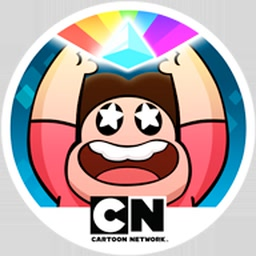

<div align="center">



# stevenrpg_nx

**Steven Universe: Attack the Light for Nintendo Switch**

An unofficial Nintendo Switch native wrapper for the 32-bit Android release of  
**Steven Universe: Attack the Light** (Grumpyface Studios / Cartoon Network).

[](#)
[](#)
[](#)
[](#)
[](LICENSE)

</div>

---

## About

`stevenrpg_nx` is a native wrapper that runs the 32-bit ARM Android build of **Steven Universe: Attack the Light 1.1.4** (`com.turner.stevenrpg`) on Nintendo Switch.

It loads the game's original Unity 5.3 libraries (`libmain.so`, `libunity.so` and `libmono.so`) and plays the part of the game's Java side: the OpenGL ES context, the activity lifecycle, touch input, FMOD's audio output, the expansion file, and the answers the game asks of a phone. The game's C# runs in its own Mono, with its JIT, on the Switch.

It is built on [aks796](https://github.com/aks796)'s [`dcr_sea_nx`](https://github.com/aks796/dcr_sea_nx) (Disney Crossy Road), whose Unity/Mono layer (the JIT's code memory, the garbage collector's thread handling, threads, FMOD audio, input) it keeps, with the offsets re-derived for Unity 5.3.

Because the Tegra X1 CPU in the Nintendo Switch natively supports 32-bit ARM (AArch32) execution, the game code runs **directly on the hardware at full native speed**, with no CPU emulation.

> [!NOTE]
> **No game code or assets are included in this repository or in the release.**  
> Users must supply their own legitimate copy of the game's APK and expansion file (OBB).

---

## Features

- **Full Native Performance:** Runs natively on the Switch ARM Cortex-A57 CPU in AArch32 mode, at 60 fps.
- **Hardware-Accelerated Graphics:** OpenGL ES via `mesa32` (Nouveau), at 720p in handheld and 1080p docked.
- **Touchscreen & Controller Support:** The game is made for touch only (its Android build has no controller support). Touch works as on mobile, and a controller plays it too, with a **virtual cursor** and swipes on the stick.
- **Sound:** The game's music and effects (FMOD) played through the Switch's audio output.
- **Movies:** The Cartoon Network and Grumpyface logos, the intro and the ending play (H.264, decoded by FFmpeg, LGPL). A button or a touch skips the logos and the intro, as on a phone.
- **Saves & HOME menu:** Progress is saved on the SD card; HOME and sleep pause and resume the game (a movie too).
- **Atmosphère & Sphaira Integration:** A dedicated launcher NRO registers a HOME menu forwarder icon.

---

## Requirements

### For Players
- A Nintendo Switch running **Atmosphère** custom firmware.
- The [Sphaira](https://github.com/ITotalJustice/sphaira) homebrew menu (Important: you need to install Sphaira's forwarder, otherwise the port won't work — the system would start it as a 64-bit program instead of 32-bit).
- A copy of **Steven Universe: Attack the Light 1.1.4** for Android (`com.turner.stevenrpg`), the APK with `lib/armeabi-v7a/` inside. The name of the APK does not matter.
- Its expansion file, **`main.52.com.turner.stevenrpg.obb`** (162 MB; on a phone it is in `Android/obb/com.turner.stevenrpg/`). The APK does not contain the game's levels, graphics, sounds and movies.

---

## Installation Guide

1. Download the latest release from the [Releases](../../releases) tab:
   - `stevenrpg_nx_0.1.0.zip`
2. Copy the `switch/stevenrpg_nx/` folder from the ZIP to the root of your SD card, so you get:
   ```text
   sdmc:/switch/stevenrpg_nx/
   ```
3. Place your APK and your OBB inside that folder:
   - `stevenrpg_nx.nro` is already there (from the ZIP).
   - Copy your APK into `sdmc:/switch/stevenrpg_nx/` (the name of the APK does not matter).
   - Copy your `main.52.com.turner.stevenrpg.obb` into `sdmc:/switch/stevenrpg_nx/obb/`.
4. The final folder structure on your SD card must look like:
   ```text
   sdmc:/switch/stevenrpg_nx/
   ├── stevenrpg_nx.nro
   ├── your-game.apk
   └── obb/
       └── main.52.com.turner.stevenrpg.obb
   ```
5. Launch **Sphaira** on your Switch:
   - Navigate to **Homebrew** › **Steven Universe: Attack the Light**.
   - Choose **Install Forwarder**.
   - Return to the Switch HOME Menu and launch the game directly from its icon!

The first start unpacks the game's libraries from the APK (about a minute, with a progress bar; again only when the APK changes). Your progress is saved in that folder too (`external/` and `data/`).

---

## Controls

| Input | Action |
| :--- | :--- |
| **Touchscreen** | Direct touch controls (identical to the mobile version) |
| **Right Stick** | Show and move the **cursor** (it fades a few seconds after you stop) |
| **A / ZR** | Tap with the cursor: menus, the battle's choices, and the timed presses (attacks, blocks, the fast taps — the game takes a tap anywhere for those) |
| **Left Stick / D-Pad** | Swipe: move from room to room in a level, page through the title and menus |
| **L / R** | Swipe a page left / right (the title and menus) |
| **B / − (Minus)** | Back / pause (Android's Back key) |
| **+ (Plus)** | Nothing |
| **During a movie** | Any button or a touch skips the logos and the intro (not the ending, as on a phone) |

---

## Configuration

`config.ini` is written to `sdmc:/switch/stevenrpg_nx/` on the first start. Changes apply the next time the game starts.

<details>
<summary>All options</summary>

| Section | Option | Values |
| :--- | :--- | :--- |
| `[display]` | `resolution` | `auto` (default: 1080 docked, 720 handheld), `720`, `1080` |
| `[performance]` | `boost_cpu_when_loading` | CPU at 1785 MHz while the game starts and in loading frames |
| `[audio]` | `mix_at_48khz` | `true` / `false` |
| `[debug]` | `gl_selftest`, `profile_long_frames`, `boot_log_on_screen`, `log_sounds` | for bug reports |

</details>

If something goes wrong, `debug.log` and `crash.log` are written next to `config.ini`. Send them with a bug report.

---

## Not in This Port

The store and purchases, ads, analytics and the online features are switched off: the game's Java side answers as a phone with no account and no network. The Android build has no controller support of its own (the Apple TV version's is in its code but switched off), hence the cursor.

---

## Building from Source

### Prerequisites
- Linux (Ubuntu / Debian / Linux Mint recommended), or Windows with PowerShell
- **Docker**
- Git

> [!IMPORTANT]
> **On Windows, run `git config --global core.autocrlf false` before cloning.** With `autocrlf=true` the runtime's scripts and Makefiles are checked out with CRLF line endings and do not run in the Linux container.

### Build Instructions

1. **Clone the repository with submodules:**
   ```bash
   git clone --recursive https://github.com/iqbalriz/stevenrpg_nx.git
   cd stevenrpg_nx
   ```

2. **Pull the required Docker toolchains:**
   ```bash
   docker pull ghcr.io/vita2hos/devcontainer/vita2hos
   docker pull devkitpro/devkita64
   ```

3. **Set up `libnx32`, `mesa32` and `ffmpeg32`:**
   - Compile `libnx32` next to this folder (the build looks for `../libnx32/prefix`):
     ```bash
     git clone https://github.com/aks796/libnx32.git ../libnx32
     ../libnx32/build.sh
     ```
   - Download the prebuilt `mesa32` release into `portlibs32/`:
     ```bash
     tools/get_portlibs.sh
     ```
     (On Windows: `tools\get_portlibs.ps1`.)
   - Build `ffmpeg32` **with the H.264 decoder** (the movies; FFmpeg 7.1.1, LGPL, downloaded and checked by its script) and copy its `lib/` and `include/` into `portlibs32/`:
     ```bash
     git clone https://github.com/aks796/ffmpeg32.git ../ffmpeg32
     FFMPEG_COMPONENTS="--enable-demuxer=mov --enable-decoder=h264 --enable-parser=h264 \
       --enable-decoder=aac --enable-parser=aac" ../ffmpeg32/build.sh
     cp -rf ../ffmpeg32/prefix/lib ../ffmpeg32/prefix/include portlibs32/
     ```
     Without it the port builds and runs, but the movies are skipped.

4. **Compile the 32-bit program:**
   ```bash
   ./build.sh
   ```
   (On Windows: `.\build.ps1`.) This makes `stevenrpg_nx.nsp`.

5. **Compile the 64-bit launcher NRO:**
   ```bash
   launcher/build.sh
   ```
   The compiled launcher will be located at `launcher/stevenrpg_nx.nro`.

The engine offsets in `source/dcr_offsets.h` and the import table in `source/imports.c` come from the game's own libraries: `tools/offsets/derive53.py <lib/armeabi-v7a> -o source/dcr_offsets.h` (it needs `pyelftools` and `capstone`) and `runtime/tools/gen_imports.py --libs <lib/armeabi-v7a>` make them again.

---

## Credits & Acknowledgments

- **Grumpyface Studios & Cartoon Network**: Original creators of Steven Universe: Attack the Light. Steven Universe is a trademark of Cartoon Network.
- **[aks796](https://github.com/aks796)**: For [`dcr_sea_nx`](https://github.com/aks796/dcr_sea_nx), the Unity/Mono port this one is built on, the [`android32`](https://github.com/aks796/android32) runtime, [`libnx32`](https://github.com/aks796/libnx32), [`mesa32`](https://github.com/aks796/mesa32), [`ffmpeg32`](https://github.com/aks796/ffmpeg32), and the movie player of [`pvz_touch_nx`](https://github.com/aks796/pvz_touch_nx) that `su_video.c` grew from.
- **FFmpeg**: The MP4 demuxer and the H.264 and AAC decoders that play the movies (LGPL v2.1+, linked statically; source at ffmpeg.org).
- **Andy Nguyen (TheOfficialFloW) & fgsfds**: Dynamic `.so` loader implementations.
- **xerpi**: For `vita2hos`, pioneer of AArch32 native execution on Switch.
- **Switchbrew**: For `libnx` and tools.
- **ITotalJustice**: For Sphaira.

---

## License

This project is licensed under the [MIT License](LICENSE).
Steven Universe is a trademark of Cartoon Network; the game is by Grumpyface Studios. This project is not affiliated with or endorsed by Cartoon Network, Grumpyface Studios, Unity Technologies or Nintendo.
